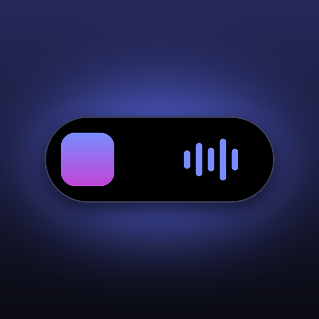

  

<h1 align="center">Island</h1>

  Dynamic Island для Windows — живая «капля» у верхнего края экрана 
  с музыкой, уведомлениями, файлами, календарём и связью с телефоном.

  <a href="../../releases/latest/download/Island-Setup.exe"><b>⬇ Скачать установщик</b></a>
  &nbsp;·&nbsp;
  <a href="../../releases/latest">Без установки (zip)</a>
  &nbsp;·&nbsp;
  <a href="../../releases/latest/download/IslandLink.apk">Island Link для Android</a>
  &nbsp;·&nbsp;
  <a href="https://t.me/dislandbot"><b>Купить Pro в Telegram</b></a>

---

## Что это

Island живёт в верхней части экрана, как Dynamic Island на iPhone. В покое это маленькая таблетка с часами и зарядом.
Наведите на неё курсор — она плавно раскрывается и показывает то, что нужно сейчас: играющий трек, загрузку,
уведомление о подключённых наушниках. Уведёте курсор — свернётся обратно.

## Возможности

**Музыка**
- Обложка, название, исполнитель, перемотка и кнопки управления для любого плеера Windows:
  Spotify, Яндекс Музыка, браузеры, Telegram и другие
- Несколько плееров сразу — переключение между ними одним кликом
- Громкость плеера прямо под треком: музыка тише или громче, остальные звуки не меняются
- Текст песни синхронно с треком, с подсветкой слов, как в караоке; текущая строка видна и на свёрнутом острове
- Остров окрашивается в цвет обложки и колышется в такт музыке
- Живой фон из обложки: размытая обложка или «сияние» её цветов (по желанию)

**Уведомления и активности**
- Громкость прямо на острове вместо ползунка Windows, заряд и зарядка, Caps Lock
- Подключение и отключение Bluetooth-устройств: наушников, мыши, геймпада
- Смена Wi‑Fi, включение и выключение VPN
- Прогресс загрузок из браузера и Telegram; готовый файл можно открыть или перетащить прямо с плашки
- Скопировали — плашка с действиями: открыть ссылку, сделать QR-код, отправить в заметки, положить файл на полку
- Напоминания о событиях календаря

**Связь с телефоном** (Island Pro; Android, приложение Island Link)
- Уведомления с телефона на острове: карточка с аватаром, именем и текстом, кнопки уведомления, ответ прямо с компьютера,
  входящие звонки с кнопками ответа и сброса
- Общий буфер обмена: текст и картинки, скопированные на одном устройстве, появляются на другом
- Фото и файлы в обе стороны: «Поделиться → На компьютер» на телефоне, «На телефон» на компьютере, с прогрессом передачи
- Режим «Не беспокоить»: уведомления с телефона тихо собираются во вкладке
- Телефон и компьютер связываются по QR-коду в одной сети, всё идёт напрямую и зашифровано

**Питомец**
- В острове живёт питомец: котята Блек или Рыжик, или Жук лимитоед
- Следит за курсором и отзывается на музыку, сообщения, загрузки и копирование, а когда вас нет — засыпает
- Можно выбрать, где он живёт и на что реагирует

**Вкладки раскрытого острова**
- **Плеер** — трек с обложкой и громкостью, а без музыки — часы, заряд и закреплённые программы
- **Полка** — бросьте файлы на остров, потом перетащите их в любое окно; файл над островом сам открывает полку, а задержанный на значке вкладки — открывает её
- **Буфер** — история скопированного, вставка в один клик; по желанию сохраняется после перезапуска
- **Текст** — заметки с оформлением (жирный, курсив, заголовки, списки), QR-коды и список задач
- **Календарь** — Google, Outlook, Яндекс, Apple (.ics)
- **Погода** — для вашего города, по часам на весь день; температура видна и рядом с часами на свёрнутом острове
- **Чат** — ИИ-ассистент с вашим ключом: бесплатные модели OpenRouter, Groq, Gemini, а также DeepSeek, Claude и ChatGPT;
  или свой сервер с API как у OpenAI (Ollama, LM Studio, прокси). Ответ печатается плавно; гайд по ключу — в настройках
- **Телефон** — центр уведомлений телефона с ответами, переданные файлы и состояние связи
- Красные отметки над вкладками: непрочитанные уведомления, новый ответ в чате, скорое событие календаря

**Оформление**
- Цвет острова и акцента, скругление, свечение; размер отдельно для свёрнутого и раскрытого острова;
  10 стилей раскрытия и 3 способа прятаться
- «Мини-остров»: в покое только часы, а обложка, аватар написавшего, Caps Lock или низкий заряд появляются сбоку, когда нужно
- «Два дела сразу»: загрузка или сообщение, пока играет музыка, — отдельной каплей рядом с островом или подсветкой по его низу
- Готовые темы и живая картинка острова в настройках: всё видно до того, как применится
- Прячется в полноэкранных играх и видео, а также в выбранных вами программах
- Можно скрыть совсем — из меню в трее или своей горячей клавишей (нажатием или пока держите)
- Режим для слабых ПК: ограничение кадров и «меньше анимации»

## Бесплатно и Pro

| | Бесплатно | Island Pro |
|---|:---:|:---:|
| Плеер с громкостью, часы, заряд, закреплённые программы | ✅ | ✅ |
| Полка, буфер обмена, календарь | ✅ | ✅ |
| Загрузки, плашки с действиями, Bluetooth, сеть и VPN | ✅ | ✅ |
| Питомец | ✅ | ✅ |
| Вкладка «Текст» (заметки, QR-коды, задачи) | — | ✅ |
| Погода | — | ✅ |
| ИИ-чат | — | ✅ |
| Текст песен | — | ✅ |
| Связь с телефоном: уведомления, общий буфер, файлы | — | ✅ |
| Оформление: цвета, форма, анимации, живая капля, свечение | — | ✅ |

**Island Pro открывается ключом из Telegram-бота [@dislandbot](https://t.me/dislandbot).**
**Первые 24 часа после установки Pro открыт бесплатно** — ничего вводить не нужно.

## Установка

1. Скачайте [`Island-Setup.exe`](../../releases/latest/download/Island-Setup.exe) и запустите.
   Windows может показать окно «Windows защитила ваш компьютер» — нажмите **«Подробнее» → «Выполнить в любом случае»**.
2. Нажмите **«Установить»**: установщик сам скачает самую новую версию. Права администратора не нужны.
3. Наведите курсор на остров вверху экрана.

Island появится в меню «Пуск» и в «Параметры → Приложения», оттуда же удаляется.
Устанавливать .NET и что-то ещё не нужно.

**Без установки:** на странице [Releases](../../releases/latest) есть архив `Island-X.Y.Z.zip` —
достаньте из него `Island.exe`, положите в постоянную папку (например `Документы\Island`) и запустите.
Чтобы остров запускался вместе с Windows, включите это в его настройках.

**Телефон:** настройки → «Телефон» → «Показать QR-код» — наведите камеру телефона, скачается
[`IslandLink.apk`](../../releases/latest/download/IslandLink.apk) (Android 8 и новее). Установите его, затем в том же разделе
подключите телефон по QR-коду. Телефон и компьютер должны быть в одной сети.

**Ключ Pro:** настройки → «Island Pro» → вставьте ключ из бота → «Активировать».

**Обновление:** Island обновляется сам — когда выходит новая версия, он предложит обновиться в один клик. Настройки и ключ сохранятся.

## Требования

- Windows 10 (2004 и новее) или Windows 11, 64-бит
- Для связи с телефоном — Android 8 и новее

## Поддержка

Вопросы, покупка и ключи — в Telegram: [@dislandbot](https://t.me/dislandbot)

Условия покупки Island Pro — [публичная оферта](OFFER.md).
