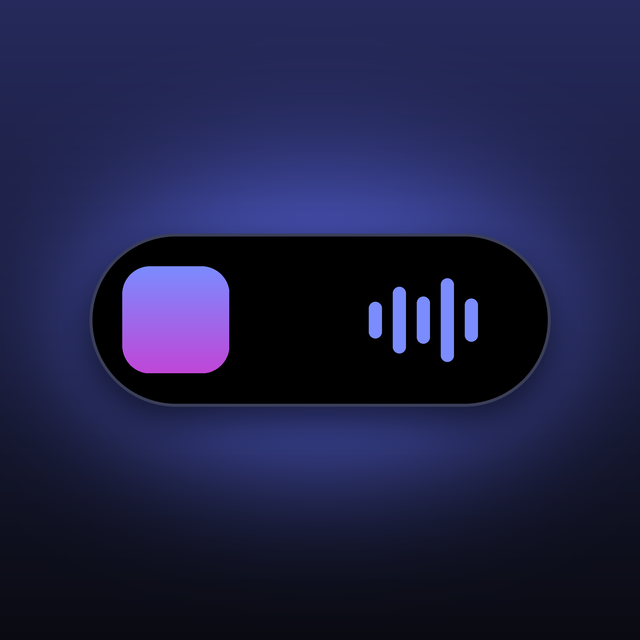

  

<h1 align="center">Island</h1>

  Dynamic Island для Windows — живая «капля» у верхнего края экрана 
  с музыкой, уведомлениями, файлами, календарём и быстрыми настройками.

  <a href="../../releases/latest"><b>⬇ Скачать последнюю версию</b></a>
  &nbsp;·&nbsp;
  <a href="https://t.me/dislandbot"><b>Купить или попробовать Pro в Telegram</b></a>

---

## Что это

Island живёт в верхней части экрана, как Dynamic Island на iPhone. В покое это маленькая таблетка с часами и зарядом.
Наведите на неё курсор — она плавно раскрывается и показывает то, что нужно сейчас: играющий трек, загрузку,
уведомление о подключённых наушниках. Уведёте курсор — свернётся обратно.

## Возможности

**Музыка**
- Обложка, название, исполнитель, перемотка и кнопки управления для любого плеера Windows:
  Spotify, Яндекс Музыка, браузеры, Telegram и другие
- Несколько плееров сразу — переключение между ними одним кликом
- Текст песни синхронно с треком, с подсветкой слов, как в караоке
- Остров окрашивается в цвет обложки и колышется в такт музыке

**Уведомления и активности**
- Громкость, заряд и зарядка, Caps Lock
- Подключение и отключение Bluetooth-устройств: наушников, мыши, геймпада
- Смена Wi‑Fi, включение и выключение VPN
- Прогресс загрузок из браузера и Telegram с кнопкой «Показать» в конце
- Напоминания о событиях календаря

**Вкладки раскрытого острова**
- **Сейчас** — плеер или часы с зарядом и звуком
- **Полка** — бросьте файлы на остров, потом перетащите их в любое окно
- **Буфер** — история скопированного, вставка в один клик
- **Текст** — заметки, QR-коды и список задач
- **Календарь** — Google, Outlook, Яндекс, Apple (.ics)
- **Погода** — для вашего города
- **Панель** — громкость, яркость, Wi‑Fi, Bluetooth, тёмная тема, сон

**Оформление**
- Цвет острова и акцента, масштаб, скругление, стиль анимации, свечение
- Прячется в полноэкранных играх и видео
- Режим для слабых ПК: ограничение кадров и «меньше анимации»

## Бесплатно и Pro

| | Бесплатно | Island Pro |
|---|:---:|:---:|
| Часы, заряд, плеер | ✅ | ✅ |
| Всплывающие громкость и заряд | ✅ | ✅ |
| Закреплённые программы | ✅ | ✅ |
| Все вкладки: полка, буфер, текст, календарь, погода, панель | — | ✅ |
| Текст песен | — | ✅ |
| Загрузки, Bluetooth, сеть и VPN | — | ✅ |
| Оформление, анимации, живая капля | — | ✅ |

**Island Pro открывается ключом из Telegram-бота [@dislandbot](https://t.me/dislandbot).**
Там же можно взять пробный ключ и протестировать все функции перед покупкой.

## Установка

1. Скачайте `Island.exe` со страницы [Releases](../../releases/latest).
2. Положите его в постоянную папку, например `Документы\Island`, и запустите.
3. При первом запуске Windows может показать окно «Windows защитила ваш компьютер» —
   нажмите **«Подробнее» → «Выполнить в любом случае»**. Это нужно один раз.
4. Наведите курсор на остров вверху экрана.

Устанавливать .NET и что-то ещё не нужно — всё внутри одного файла.
Чтобы остров запускался вместе с Windows, включите это в настройках (шестерёнка справа от вкладок).

**Ключ Pro:** настройки → «Island Pro» → вставьте ключ из бота → «Активировать».

**Обновление:** замените старый `Island.exe` новым — настройки и ключ сохранятся.

## Требования

- Windows 10 (2004 и новее) или Windows 11, 64-бит

## Поддержка

Вопросы, ключи и пробный период — в Telegram: [@dislandbot](https://t.me/dislandbot)
